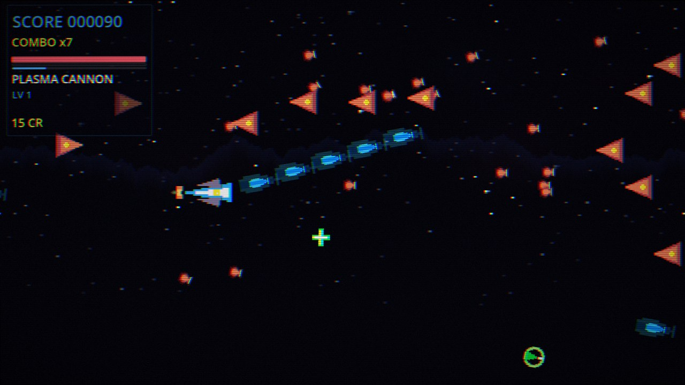
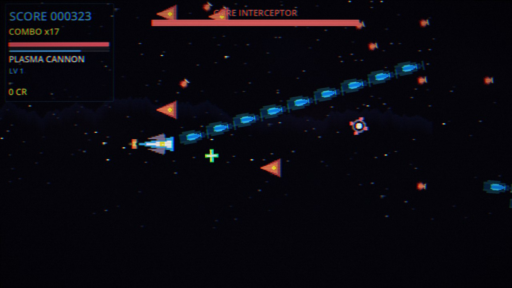
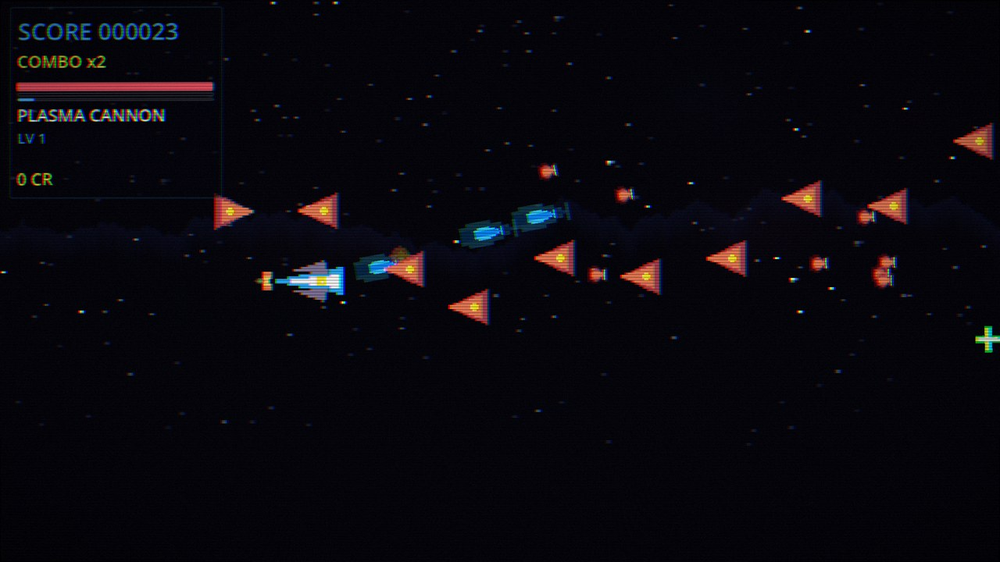
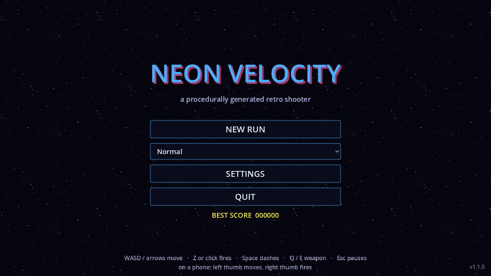
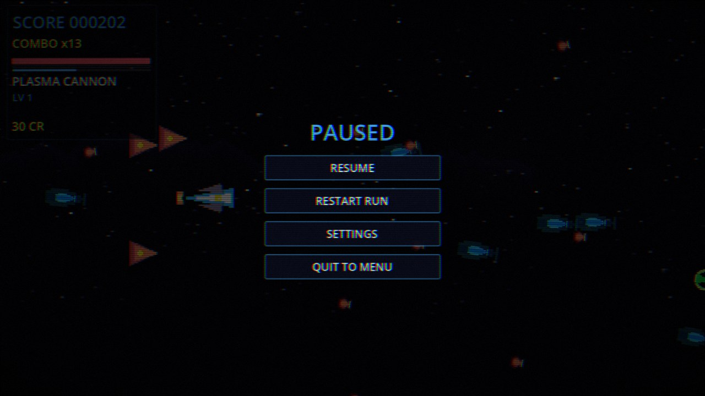

[](https://github.com/drsamonline/neon-velocity/actions/workflows/build.yml)
[](https://github.com/drsamonline/neon-velocity/releases)
[](LICENSE)
[](https://godotengine.org)
[](#downloads)
[](https://drsamonline.github.io/neon-velocity/)

# Neon Velocity

**Play in the browser:** <https://drsamonline.github.io/neon-velocity/play/> — it
installs as an app (PWA) and works offline after the first load.
**Landing page:** <https://drsamonline.github.io/neon-velocity/>



| | |
|---|---|
|  |  |
| The Core Interceptor, first of four bosses | Drone formations converging |
|  |  |
| Title screen, difficulty select | Pause menu |

A retro side-scrolling shooter for **Godot 4.3** where every sprite and every
sound is generated at runtime. The repository contains no binary assets at all:
no PNGs, no OGGs, no fonts — just GDScript, three shaders and two scene files.

```
godot --path .          # or open the folder in the Godot 4.3 editor and press F5
```

There is also a **web build that installs as an app** (PWA) — see
[Play in a browser](#play-in-a-browser-pwa).

## Controls

| Action | Keys |
|--------|------|
| Move | `WASD` / arrow keys |
| Fire | `Z` or left mouse button |
| Dash (brief invulnerability) | `Space` / `Shift` |
| Switch weapon | `Q` / `E` |
| Pause | `Esc` |

On a phone or tablet the game draws its own controls: drag anywhere on the left
half to fly, `FIRE` and `DASH` sit under the right thumb, and `WPN` / pause are
in the top-right corner. Turn the device to landscape — portrait shows a
"rotate your device" screen. On the web build the first tap also asks for
fullscreen and a landscape lock.

## Play in a browser (PWA)

The project exports to Web, and the export is patched into a real installable
PWA: manifest, icons, service worker, offline page. It is single-threaded, so it
does **not** need `Cross-Origin-Opener-Policy` / `Cross-Origin-Embedder-Policy`
headers and will run on any static host, including GitHub Pages, Netlify,
Cloudflare Pages and itch.io.

```bash
godot --headless --path . --export-release "Web" build/web/index.html
python3 tools/pwa_post_export.py build/web

# local preview (service workers need http, not file://)
python3 -m http.server 8000 --directory build/web
# then open http://localhost:8000
```

The first load pulls a ~35 MB wasm bundle; after that the service worker serves
it from cache and the game starts instantly, including offline. Install it from
the browser's address bar ("Install") to get a standalone window and an icon.

Two things to know: a **keyboard is required** (there are no touch controls),
and the page must be served over **HTTPS or localhost** — service workers are
refused on plain `http://` origins.

`tools/pwa_post_export.py` does two things the raw export does not: it registers
the service worker (Godot only does that for thread-enabled builds) and it
prunes the worker's precache list, which otherwise lists `index.worker.js` in
thread-less builds — one 404 there makes `cache.addAll()` reject and silently
kills offline support.

## What is in the game

- **Six weapons** — plasma cannon, spread shot, laser lance, seeker missiles,
  railgun, nova burst. Each has five levels and gains XP from kills.
- **18 mods** — stat modifiers and named effects (chain lightning, ricochet,
  life siphon, MIRV split, EMP slow, multi-pulse nova). Picking up a mod card
  pauses the run and offers three choices.
- **Endless procedural levels** — the world is a strip of 2400-unit chunks,
  each generated from `run_seed + chunk_index`, so a seed always replays the
  same run.
- **Four bosses** on a five-chunk cycle, each with its own attack patterns and
  a phase change every quarter of its health.
- **Full loop** — title screen, difficulty select, HUD, pause menu, settings,
  run summary with accuracy and best score, local save file.
- **Adaptive music** — four synthesised layers (bass, lead, pad, drums) that
  fade in as you get deeper into a run, plus 24 procedural sound effects.

## How the "zero assets" trick works

| Thing | Where it comes from |
|-------|---------------------|
| Sprites | `scripts/core/Art.gd` rasterises every image with the `Image` API from a fixed 16-colour palette, then wraps it in an `ImageTexture` |
| Sound effects | `scripts/core/AudioManager.gd` synthesises PCM float buffers (FM, sweeps, noise, arpeggios) and packs them into `AudioStreamWAV` |
| Music | The same file builds four 6.857 s loops at 140 BPM and crossfades them |
| Level art | Starfield, nebula and mountain silhouettes are generated once and tiled by `ParallaxBackground` |

Audio generation takes roughly half a second at startup on a modest laptop, all
of it before the title screen appears.

## Project layout

```
scripts/
  core/        EventBus, SaveSystem, Art (sprites), AudioManager, ObjectPool
  systems/     WeaponSystem, LevelManager, GameManager, ReplaySystem
  entities/    Player, Bullet, Powerup
  enemies/     DroneEnemy, CoreBoss
  effects/     Spark, Explosion
  ui/          HUD, MainMenu, SettingsMenu, PauseMenu, ModSelect, GameOverScreen
  tools/       test_runner (headless smoke test), dump_sprites (art previews)
scenes/        Main, MainMenu, SettingsMenu, TestRunner, tools/{DumpSprites,SoakTest}
shaders/       crt_palette_combined, player_glow, palette_shift
web/           PWA icons + offline page (inputs to the web export)
tools/         pwa_post_export.py, ci_install_godot.sh
docs/          SPEC.md (the original brief), REVIEW.md (audit of that brief)
```

## Testing

```bash
# headless smoke test: boots Main, plays 7 seconds of synthetic input, asserts 27 things
godot --headless --path . res://scenes/TestRunner.tscn

# 50-second soak run: chunk streaming, pooling and the first boss fight
godot --headless --path . res://scenes/tools/SoakTest.tscn

# dump every generated sprite to art_preview/ for inspection
godot --headless --path . res://scenes/tools/DumpSprites.tscn
```

The test runner exits non-zero on failure, so CI can gate on it.

## Builds and releases

`export_presets.cfg` defines four presets: Web, Linux, Windows and macOS.
Export templates must be installed first (Editor → Manage Export Templates).

```bash
godot --headless --path . --export-release "Linux/X11"      build/linux/NeonVelocity.x86_64
godot --headless --path . --export-release "Windows Desktop" build/windows/NeonVelocity.exe
godot --headless --path . --export-release "macOS"          build/macos/NeonVelocity.zip
godot --headless --path . --export-release "Web"            build/web/index.html
```

Everything is automated in `.github/workflows/build.yml`:

| Trigger | What happens |
|---------|--------------|
| any push / PR | headless smoke test + 50-second soak test |
| push to `main` | the above, then the Web build is patched into a PWA and deployed to GitHub Pages |
| `v*` tag | the above, then Linux, Windows, macOS and Web are exported and attached to a GitHub release |
| manual dispatch | same as a tag, without publishing a release |

So shipping a new version is `git tag v1.1.0 && git push --tags`.

Note on Pages: GitHub Pages needs a **public** repository on the free plan, so
the Pages job is opt-in. To turn it on, make the repository public, enable Pages
with "GitHub Actions" as the source, then set a repository variable
`ENABLE_PAGES=true` (Settings -> Secrets and variables -> Actions -> Variables).
Every push to `main` will then publish the PWA. Until then, take
`neon-velocity-web.zip` from the release and drop the unzipped folder on any
static host — Netlify, Cloudflare Pages, itch.io and GitHub Pages all work,
because the build needs no special headers.

## Saves and replays

Settings live in `user://settings.cfg`, the last run and lifetime stats in
`user://save_game.save` (JSON, XOR-obfuscated — not encrypted, and not meant to
be), and recorded inputs in `user://replays/`.

Replays are **recorded, not yet playable**: each run writes a JSON file with the
seed, difficulty and three bytes of input per frame, which is everything needed
to re-simulate it, but no playback UI is wired up yet.

## License

PolyForm Noncommercial — see `LICENSE`.
